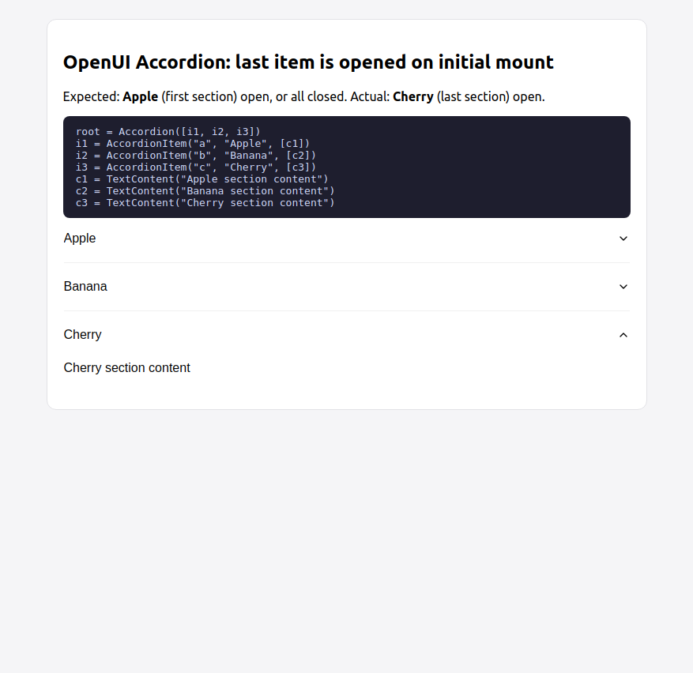

# OpenUI `<Accordion>` opens the **last** item on initial mount

Minimal reproduction against the published npm packages:

- `@openuidev/react-ui@0.13.1`
- `@openuidev/react-lang@0.2.9`
- `@openuidev/react-headless@0.9.3`

## What happens

Rendering a static (non-streaming) response with three accordion sections:

```
root = Accordion([i1, i2, i3])
i1 = AccordionItem("a", "Apple", [c1])
i2 = AccordionItem("b", "Banana", [c2])
i3 = AccordionItem("c", "Cherry", [c3])
c1 = TextContent("Apple section content")
c2 = TextContent("Banana section content")
c3 = TextContent("Cherry section content")
```

- **Expected:** the first section (`Apple`) is open on mount, or all sections
  start closed.
- **Actual:** the last section (`Cherry`) is open on mount.



## Run it

```sh
npm install
npm run dev
# open http://localhost:5176 — the "Cherry" section is open
```

## Root cause

In `packages/react-ui/src/genui-lib/Accordion/index.tsx`, the auto-open logic
runs during render and treats any growth in item count as "a new item arrived
during streaming":

```tsx
const [openItem, setOpenItem] = React.useState<string>("");
const userHasInteracted = React.useRef(false);
const prevItemCount = React.useRef(0);

// Auto-open: only when a NEW item arrives during streaming
if (!userHasInteracted.current && items.length > prevItemCount.current) {
  const newest = items[items.length - 1];
  if (newest) setOpenItem(newest.props.value);
}
prevItemCount.current = items.length;
```

On the very first render `prevItemCount.current` is `0`, so a fully static
N-item accordion satisfies `items.length > 0` and the branch opens
`items[items.length - 1]` — the **last** section. The baseline pass is
indistinguishable from streaming growth.

This is the same defect shape as the `<Tabs>` issue
([thesysdev/openui#819](https://github.com/thesysdev/openui/issues/819)):
a streaming "follow the newest content" heuristic that doesn't exclude the
initial mount. The earlier Accordion implementation had a mount effect that
opened the **first** item; the refactor in thesysdev/openui#485 removed it,
leaving only the auto-open-newest branch.

### Related streaming latch in the same branch

The same code has a second problem while actually streaming: when a new item
appears before its `value` string has finished streaming, `setOpenItem` latches
a *prefix* of the value (e.g. `"ov"` for `"overview"`). Since the only re-sync
trigger is item-**count** growth, the completed value never re-syncs, the
latched prefix matches no item, and the accordion ends up with **no** section
open (items are not filtered for complete values, unlike `Tabs`, which filters
`value != null`).

## Suggested fix

Skip the auto-open pass on the baseline render (e.g. initialize
`prevItemCount` from the first non-empty `items.length`, mirroring the Tabs
fix), and only auto-open items whose `value` is complete.
